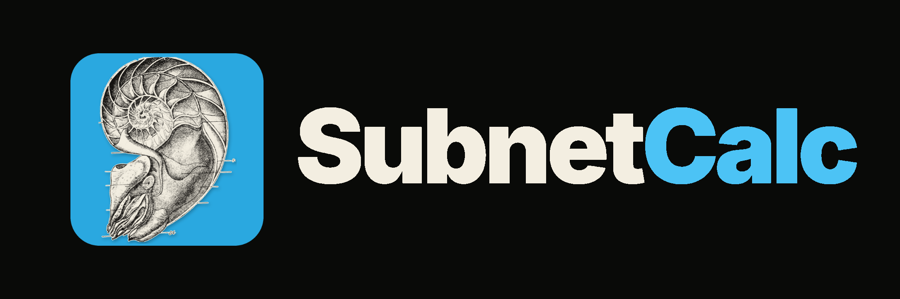
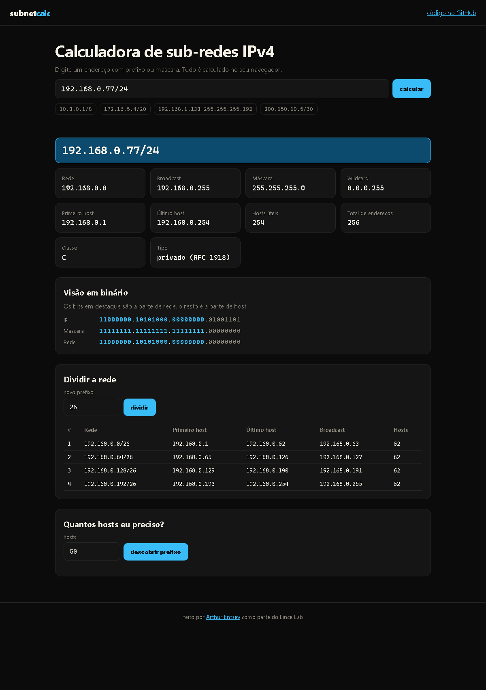

<p align="center"><sub>Subnet Calc</sub></p>

---

<p align="center">
  
</p>

<p align="center">
  Calculadora de sub-redes IPv4 em JavaScript puro com visão em binário e divisão de redes
</p>

<p align="center">
  
  
  <a href="https://github.com/arthurlynow098/subnet-calculator/actions/workflows/testes.yml"></a>
  <a href="https://arthurlynow098.github.io/subnet-calculator/"></a>
</p>

## Sobre o projeto

Sub-rede foi o primeiro assunto de redes que me travou de verdade. Dá para decorar que um /24 tem 254 hosts, mas eu só entendi **por que** quando vi os bits. Então fiz uma calculadora que mostra o endereço em binário com a parte de rede destacada, divide uma rede em sub-redes menores e responde a pergunta mais comum do dia a dia, que é "qual prefixo eu uso para caber N máquinas?".

Roda inteira no navegador, sem framework e sem servidor.

<p align="center"></p>

## Como funciona

Um IPv4 é só um número de 32 bits escrito em quatro pedaços. Com isso, todo o cálculo vira operação de bits

## Tecnologias

<p>
  
  
  
</p>

## Executando o código

Online em **[arthurlynow098.github.io/subnet-calculator](https://arthurlynow098.github.io/subnet-calculator/)**.

Localmente é só servir a pasta (módulos ES não carregam abrindo o arquivo direto)

```bash
git clone https://github.com/arthurlynow098/subnet-calculator.git
cd subnet-calculator
python -m http.server 8000
# abra http://localhost:8000
```

Testes (Node 20 ou mais novo, sem instalar nada)

```bash
npm test
```

A URL guarda o que foi digitado, então dá para mandar o link de um cálculo específico para alguém.

## Exemplo

```text
$ npm test

✔ ida e volta de IP para número
✔ rejeita IP inválido
✔ /24 clássico
✔ aceita máscara decimal
✔ /31 e /32 seguem a RFC 3021
✔ divide /24 em quatro /26
✔ prefixo mínimo para N hosts
✔ tipos de endereço
ℹ tests 8
ℹ pass 8
```

## Estudei por aqui

Segui essas aulas e materiais para entender e aplicar tudo que está aqui.

| Material | O que tirei dele |
|---|---|
| [TryHackMe, What is Networking?](https://tryhackme.com/room/whatisnetworking) | Base de IP, sub-redes e como os pacotes chegam |
| [RFC 1918](https://www.rfc-editor.org/rfc/rfc1918) | As faixas de endereço privado |
| [RFC 4632, CIDR](https://www.rfc-editor.org/rfc/rfc4632) | A notação com barra e como o prefixo funciona |
| [MDN, JavaScript](https://developer.mozilla.org/pt-BR/docs/Web/JavaScript) | Operadores de bit e módulos ES |
| [GitHub Pages](https://docs.github.com/en/pages/getting-started-with-github-pages) | Publicação do site |

## Licença

Distribuído sob a licença MIT. Veja o arquivo [LICENSE](LICENSE).

<p align="center"><sub>A gravura do banner é o náutilo do livro Introduction to Zoology, de 1900, em domínio público no <a href="https://commons.wikimedia.org/wiki/File%3AImage_from_page_192_of_%22Introduction_to_zoology%3B_a_guide_to_the_study_of_animals%2C_for_the_use_of_secondary_schools%3B%22_%281900%29_%2814598317340%29.jpg">Wikimedia Commons</a>.</sub></p>
