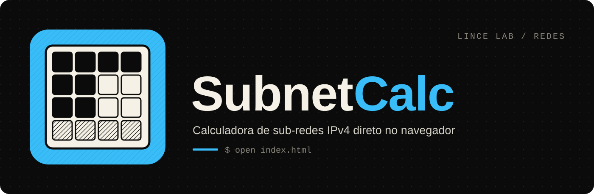

<a id="top"></a>

<p align="center"></p>

<p align="center">


<a href="https://github.com/arthurlynow098/subnet-calculator/actions/workflows/testes.yml"></a>
<a href="https://arthurlynow098.github.io/subnet-calculator/"></a>
</p>

<p align="center"><a href="#sobre">Sobre</a> &nbsp;&nbsp; <a href="#como-funciona">Como funciona</a> &nbsp;&nbsp; <a href="#rodando">Rodando</a> &nbsp;&nbsp; <a href="#aprendi">O que aprendi</a> &nbsp;&nbsp; <a href="#estudos">Estudos</a></p>

<a id="sobre"></a>

<p></p>

Sub-rede foi o primeiro assunto de redes que me travou de verdade. Dá para decorar que um /24 tem 254 hosts, mas eu só entendi **por que** quando vi os bits. Então fiz uma calculadora que mostra o endereço em binário com a parte de rede destacada, divide uma rede em sub-redes menores e responde a pergunta mais comum do dia a dia, que é "qual prefixo eu uso para caber N máquinas?".

Roda inteira no navegador, sem framework e sem servidor.

<p align="center"></p>

<a id="como-funciona"></a>

<p></p>

Um IPv4 é só um número de 32 bits escrito em quatro pedaços. Com isso, todo o cálculo vira operação de bits

| O que calcula | Conta |
|---|---|
| Máscara | `0xFFFFFFFF << (32 - prefixo)` |
| Rede | `ip AND máscara` |
| Broadcast | `rede OR NOT máscara` |
| Hosts úteis | `2^(32 - prefixo) - 2` (rede e broadcast não contam) |

Detalhes que deram trabalho

- **O `>>> 0` em todo lugar.** Em JavaScript as operações de bit trabalham com inteiro de 32 bits **com sinal**. Sem o `>>> 0`, o IP `192.168.0.1` vira um número negativo e tudo quebra.
- **/31 e /32.** Pela RFC 3021, um /31 é um link ponto a ponto com 2 hosts úteis. Um /32 é um host só. A regra do "menos 2" não vale aqui.
- **Máscara decimal inválida.** `255.0.255.0` não é máscara, porque os bits 1 precisam vir todos juntos. A calculadora detecta e avisa.
- **Tipos de endereço.** Identifica faixa privada (RFC 1918), loopback, APIPA, CGNAT e as faixas de documentação.
- **Segurança.** Toda saída na página usa `textContent`, nunca `innerHTML` com o que foi digitado.

A lógica fica em `src/subnet.js`, separada do DOM, e por isso é testada direto no Node com o test runner nativo.

<a id="rodando"></a>

<p></p>

Online em **[arthurlynow098.github.io/subnet-calculator](https://arthurlynow098.github.io/subnet-calculator/)**.

Localmente é só servir a pasta (módulos ES não carregam abrindo o arquivo direto)

```bash
git clone https://github.com/arthurlynow098/subnet-calculator.git
cd subnet-calculator
python -m http.server 8000
# abra http://localhost:8000
```

Testes (Node 20 ou mais novo, sem instalar nada)

```bash
npm test
```

A URL guarda o que foi digitado, então dá para mandar o link de um cálculo específico para alguém.

<p></p>

```text
$ npm test

✔ ida e volta de IP para número
✔ rejeita IP inválido
✔ /24 clássico
✔ aceita máscara decimal
✔ /31 e /32 seguem a RFC 3021
✔ divide /24 em quatro /26
✔ prefixo mínimo para N hosts
✔ tipos de endereço
ℹ tests 8
ℹ pass 8
```

<a id="aprendi"></a>

<p></p>

- Sub-rede de verdade, enxergando os bits em vez de decorar tabela
- Operações de bit em JavaScript e a pegadinha do inteiro com sinal
- Separar regra de negócio da interface para conseguir testar
- Test runner nativo do Node, sem Jest nem dependência nenhuma
- Publicar site estático no GitHub Pages

Próximos passos

- [ ] Suporte a IPv6
- [ ] VLSM, dividir uma rede em pedaços de tamanhos diferentes
- [ ] Modo exercício, que sorteia um IP e pede para a pessoa responder

<a id="estudos"></a>

<p></p>

Segui essas aulas e materiais para entender e aplicar tudo que está aqui.

| Material | O que tirei dele |
|---|---|
| [TryHackMe, What is Networking?](https://tryhackme.com/room/whatisnetworking) | Base de IP, sub-redes e como os pacotes chegam |
| [RFC 1918](https://www.rfc-editor.org/rfc/rfc1918) | As faixas de endereço privado |
| [RFC 4632, CIDR](https://www.rfc-editor.org/rfc/rfc4632) | A notação com barra e como o prefixo funciona |
| [MDN, JavaScript](https://developer.mozilla.org/pt-BR/docs/Web/JavaScript) | Operadores de bit e módulos ES |
| [GitHub Pages](https://docs.github.com/en/pages/getting-started-with-github-pages) | Publicação do site |

<p align="center"><sub>Parte do <a href="https://github.com/arthurlynow098">Lince Lab</a>, minha coleção de projetos</sub></p>

<p align="center"><a href="#top">Voltar ao topo</a></p>
